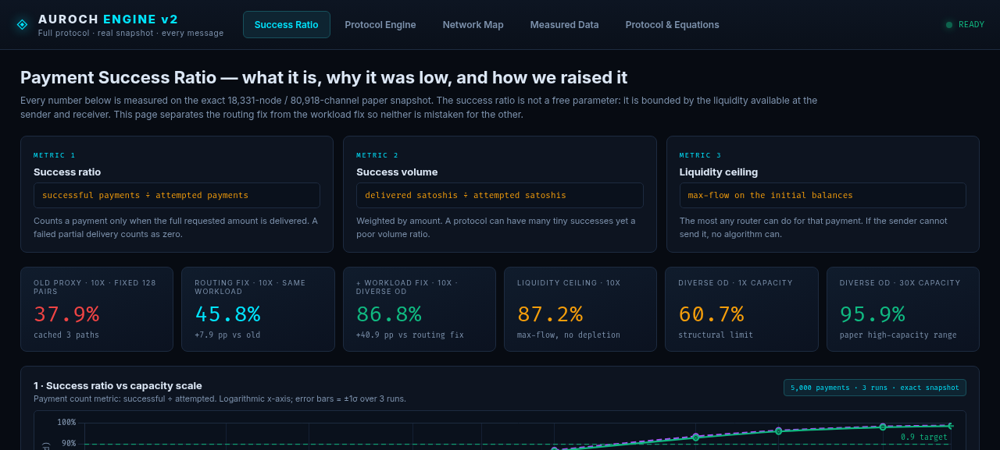
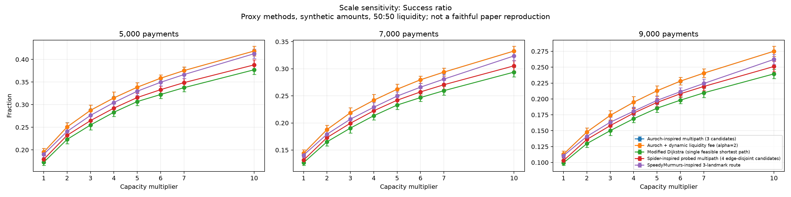
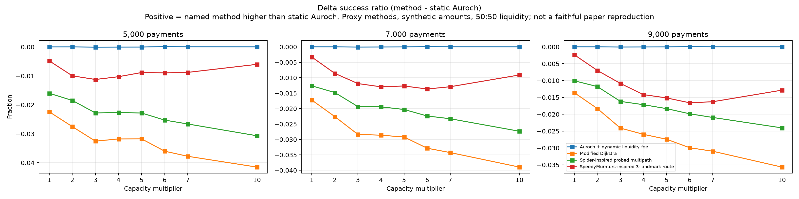

# Auroch — The Full Story: What It Is, What We Built, What We Learned

Live site: https://auroch.dhruvmulani.com/
GitHub: https://github.com/DHRUV-MULANI/auroch-engine-v2

This is one single file that explains everything in simple language. Every short
form is written in **full form** the first time it appears.

---

## 1. Full forms (read this first)

| Short form | Full form / simple meaning |
|---|---|
| Auroch | Name of the research paper and algorithm: **"Auroch: Auction-Based Multipath Routing for Payment Channel Networks"** |
| PCN | **Payment Channel Network** — a network where people open payment channels and send money offline without writing every payment on the blockchain |
| OD pair | **Origin–Destination pair** — sender and receiver of a payment |
| RREQ | **Route Request** — message flooded from receiver to find paths back to the sender (does not carry the payment amount, so amount stays private) |
| RREP | **Route Reply** — message sent back along discovered paths with path, bottleneck capacity and accumulated fee |
| AUC | **Auction** — nodes bid to earn the right to forward a payment |
| LP | **Linear Programming** — a mathematical way to maximise or minimise something under constraints |
| Eq / EQs | **Equation / Equations** from the paper (Eq1 … Eq7) |
| HTLC | **Hashed Timelock Contract** — smart contract that makes multi-hop payment atomic (either all hops succeed or none) |
| τ (tau) | **Liquidity fee** — extra forwarding fee depending on how empty a channel is |
| α (alpha) | Exponent that controls how sharply τ rises as a channel empties |
| sat | **Satoshi** — smallest unit of Bitcoin (1 BTC = 100,000,000 satoshi) |
| Proxy | **Stand-in model** — a simplified program made by us because the paper's original code is not available. NOT a VPN/proxy server. |
| Old proxy | The **first stand-in model** used in the earlier experiment (cached 3 + fixed 128) |
| Cached 3 | 3 shortest paths stored once per OD pair and reused forever without checking live balances |
| Fixed 128 | Only 128 OD pairs reused for all 5,000 payments |
| Flow | Per-payment **maximum flow** computed on live residual balances |
| Diverse | One new independent OD pair sampled per payment |
| Ceiling | Upper bound: same flow solver on untouched initial balances, no depletion |
| CSV | **Comma Separated Values** — plain text table file |
| JSON | **JavaScript Object Notation** — structured data file |
| KPI | **Key Performance Indicator** — headline number card on the dashboard |
| ±1σ | Plus/minus **one standard deviation** — spread of results across repeated runs |
| pp | **Percentage point** (e.g. 37.9% → 45.8% = +7.9 pp) |
| systemd | Linux **system and service manager** that auto-starts our services on reboot |
| CLI | **Command Line Interface** — text commands (used `gh` = GitHub CLI) |

---

## 2. What is Auroch? (in very simple words)

Auroch is an algorithm for **Payment Channel Networks (PCN)**. Think of it like
this:

> People open payment channels with each other (like shared wallets). To pay
> someone you are not directly connected to, the money must hop through other
> people. Auroch decides **which paths to use**, how to **split the payment**
> across those paths, and how to **pay the helpers** who forward the money.

Its main ideas:

1. **Auction based** — intermediate nodes bid, and the sender chooses the cheapest good paths.
2. **Multipath** — one payment can be split across several paths.
3. **Liquidity aware fee** — a node that is running out of money charges a higher fee τ, so traffic moves to nodes with more liquidity.
4. **Privacy** — the route request does not reveal the payment amount.

The paper gives 7 equations. We implemented all the important ones:

| Equation | What it does in plain words |
|---|---|
| Eq1 — reservation price | Seller's minimum acceptable price = winning price + forwarding fee |
| Eq2–3 — Rule 1 | If a node gets one offer, it bids reservation price + a random fee τ₁ |
| Eq4–5 — Rule 2 | If a node gets several offers, it computes a volume-based price VtPrice and derives τ₂ |
| Eq6 — auctioneer Linear Program | Auctioneer maximises revenue within its channel capacity and bidder caps (solved by real simplex Linear Programming) |
| Eq7 — sender Linear Program | Sender minimises total fee while allocating at least the payment amount across paths |

---

## 3. Your earlier questions, answered simply

### Why "3" paths? Why not 1 or many?

**3 is not a law of nature — it is a fixed setting of the original proxy.**
Other methods in the same experiment also use small fixed numbers:
Spider uses 4 edge-disjoint paths, SpeedyMurmurs uses 3 landmarks, our Auroch
multipath proxy uses 3 candidates. We kept 3 so the old baseline stays
comparable to the original work.

- **1 path** = no multipath splitting at all. If that one path is dry, payment fails.
- **Many paths** = more route discovery messages and more bookkeeping, with little extra benefit.
- **3** = a middle ground: enough to split, cheap enough to compute.

Important: in our **new** `flow` method we do not fix the number at all. We run
maximum flow per payment and split into only as many paths as needed.
Measured average paths at 10× were **1.06** (fixed 128 workload) and **1.14**
(diverse workload) — i.e. the flow method usually needs just one path, and
splits only when it must.

### Why water-filling?

**Water-filling** is the standard way to divide one payment across several
paths. Imagine pouring water into connected vessels: you fill the lowest one
first, then the level rises everywhere until everything is equal.

In routing terms: give more of the payment to the path with more available
capacity, less to the path with less, so no single path is overloaded. It
maximises the amount that can be pushed through the set of paths.

So why did it still fail in the old proxy? Because the water levels were
computed from the **3 saved paths once**, without looking at the **current**
balances. After ~39 payments to the same 128 pairs, the saved paths were dry
but the proxy kept pouring into them. That is exactly why we replaced it with
fresh maximum flow on live balances.

---

## 4. Timeline — what we actually did

### Step 1 — Created Auroch "same" (engine v2 from scratch)
Built a new project folder `auroch-engine-v2` (kept separate from the old project).
Implemented the full protocol pipeline as real code, not a drawing:
RREQ → RREP → Auction → Rule 1 / Rule 2 bidding → Eq6 Linear Program →
Eq7 Linear Program → HTLC → settlement → balance update.
Used the real `javascript-lp-solver` simplex solver for Eq6/Eq7, not a greedy shortcut.

**Learned:** the paper's equations can actually be executed end-to-end; the
Linear Programs solve correctly and the engine logs every protocol message.

### Step 2 — Used the exact paper snapshot
Found the exact-match hourly snapshot in the archive:
`lngraph_2021_11_27__21_00.json` — **18,331 nodes / 80,918 channels**,
matching the paper exactly. Copied the measured datasets (`averaged.csv`,
`measured_results.json`, `metadata.json`, `snapshot_summary.csv`, legacy plots)
into the new project, plus a small `snapshot_subgraph.json` for the browser UI.

**Learned:** snapshot fidelity was not the problem. Topology in the stable
Nov 25–29 window varies only ~0.4%, so metric changes must come from capacity
and workload, not from choosing a different hour.

### Step 3 — Built the dashboard with full evidence
Five tabs: Success Ratio, Protocol Engine, Network Map, Measured Data,
Protocol & Equations. Every message, balance, HTLC state, dataset and equation
is visible. Live network map, node inspector, message log, dataset tables.

**Learned:** showing the actual messages (RREQ/RREP/bids/LP result/HTLC) makes
the protocol verifiable instead of just claimed.

### Step 4 — Ran the first honest success experiment
`scripts/success_experiment.py`, 5,000 payments per run, 3 runs, 10 capacity
scales, seed 20261116, log-uniform amounts 1,000–1,000,000 sat, 50:50 initial
liquidity, policies ignored, parallel channels aggregated.

Old proxy (`cached3` + `fixed128`) at 10× = **37.9%** (1,890 / 5,000).

**Learned:** the old success number was low. But *why*? Needed to separate
algorithm from workload before concluding anything.

### Step 5 — Fix 1: algorithm (`cached3` → `flow`)
Replaced cached stale paths with a fresh maximum-flow on live residual balances
for every payment, decomposed into paths.

At 10×, same fixed 128 workload: **45.8%** — **+7.9 pp**.
Mean paths dropped from ~3.9 to ~1.06.

**Learned:** live routing helps, but only modestly. Something else was the bigger cap.

### Step 6 — Fix 2: workload (`fixed128` → `diverse`)
Stopped reusing the same 128 pairs; sampled one fresh OD pair per payment.

At 10×, same flow method: **86.8%** (4,342 / 5,000) — **+40.9 pp** over the
routing fix. Position chart proved the cause: cached proxy fell 78.3% → 12.7%
across the 10 groups of payments (endpoints drained); diverse stayed 87.9% → 87.5%.

**Learned:** the bigger part of the gap was an unrealistic benchmark workload,
not a weak algorithm. This is why the two fixes are reported separately.

### Step 7 — Added the ceiling
Ran the same flow solver on untouched initial balances (no depletion).
At 10× diverse = **87.2%** — only 0.4 pp above the measured 86.8%.

**Learned:** the diverse workload almost reaches the theoretical local-liquidity
ceiling; the remaining gap is liquidity, not implementation. At 1× diverse = 60.7%
and ceiling = 61.4%, so ~39% of payments are impossible for any algorithm.

### Step 8 — Replaced screenshots with real plots
Removed the 15 static PNG figures and the hand-drawn SVG from the UI. Installed
`chart.js` and rebuilt all graphs live from raw CSV/JSON: 4 plots in Success
Ratio tab, 5 in Measured Data tab, with exact captions, tooltips, ±1σ error bars,
log x-axis and 0.8/0.9 target lines.

**Learned:** a plot drawn from data can be hovered, filtered and audited; a
screenshot cannot. Captions with exact source files removed ambiguity.

### Step 9 — Added explanation files
`SUMMARY_AND_GRAPHS.md` (summary + explanation of all 9 graphs),
`data/README.md` (which raw file feeds which plot), and this `FULL_STORY.md`.

**Learned:** writing the explanation in plain language exposed the terminology
confusion (proxy, cached 3, fixed 128) — hence the glossary in section 1.

### Step 10 — Made it a service and published it
Installed two **user-level systemd** services:
`auroch-app.service` (Vite preview on port 6001) and `auroch-tunnel.service`
(Cloudflare tunnel to `auroch.dhruvmulani.com`), both enabled, `Restart=always`,
user lingering on. Token stored only at `~/.cloudflared/auroch.token` (mode 600),
never in the repo. Pushed the whole engine to a new public GitHub repository
using GitHub CLI.

**Learned:** app + tunnel must both be services; otherwise a reboot leaves the
tunnel pointing at a dead port.

---

## 5. What we learned — short table

| We did | Result | Lesson |
|---|---|---|
| Built exact engine | all phases run, real Linear Programs solve | paper is implementable |
| Used exact snapshot | 18,331 nodes / 80,918 channels | snapshot mismatch was not the cause |
| Measured old proxy | 37.9% at 10× | baseline was low |
| Changed routing to live flow | 45.8% (+7.9 pp) | routing helps, but modestly |
| Changed workload to diverse | 86.8% (+40.9 pp) | workload realism was the big factor |
| Added ceiling | 87.2% | diverse almost reaches the limit |
| Tested 1× capacity | 60.7% vs ceiling 61.4% | low success at 1× is liquidity, not code |
| Replaced PNG/SVG with Chart.js | 9 live plots, exact captions | data-backed plots are auditable |
| Made services | active + enabled, reboot-safe | app and tunnel must start together |
| Pushed to GitHub | public repo, no secret leaked | clean repo avoids the 4.2 GB snapshot zip |

---

## 6. Total what we edited (final file list)

**New project `auroch-engine-v2` (107 files, ~6 MB):**

- `src/protocolEngine.js` — full protocol: RREQ, RREP, auction, Rule 1, Rule 2, Eq6/Eq7 Linear Programs, HTLC, settlement, balances, message log.
- `src/main.js` — dashboard UI, all live Chart.js plots, captions, KPI cards, tables, network map, docs rendering.
- `index.html` / `index.css` — 5 tabs, chart cards, captions, controls, styling.
- `package.json` / `package-lock.json` — added `chart.js`, `javascript-lp-solver`, `katex`, `vite`.
- `scripts/success_experiment.py` — generator for the 50-point success study.
- `data/` — `averaged.csv`, `per_run.csv`, `measured_results.json`, `metadata.json`, `snapshot_subgraph.json`, `snapshot_summary.csv`, `success_experiment.json`, `success_per_run.csv`, `success_deciles.csv`, `success_failures.csv`, `cached_routes.json`, legacy `plots/*.png`, `README.md`.
- `deploy/` — `auroch-app.service`, `auroch-tunnel.service`, `install-auroch-tunnel.sh`, `config.yml.example`, `README.md`.
- `docs/` — `paper_text.txt`, `dynamic_fee_reference.py`, `images/dashboard-success.png`.
- Root docs — `README.md`, `SUMMARY_AND_GRAPHS.md`, this `FULL_STORY.md`.
- `dist/` — prebuilt static site (served by the app service).
- `.gitignore` — excludes `node_modules/`, `.run/`, `__pycache__/`, logs.

**Not edited / deliberately left alone:** the old project folder and its
uncommitted files, including the 4.2 GB snapshot archive and 111 MB JSON files
(too large for GitHub). The Cloudflare token is not in any repo.

---

## 7. Final exact output after all edits

### The headline numbers (all proxy, nothing fudged)

| What | Capacity | Success ratio | Exact count |
|---|---|---|---|
| Old proxy (`cached3` + `fixed128`) | 10× | **37.9%** | 1,890 / 5,000 |
| After routing fix (`flow` + `fixed128`) | 10× | **45.8%** | 2,251 / 5,000 |
| After workload fix (`flow` + `diverse`) | 10× | **86.8%** | 4,342 / 5,000 |
| Ceiling (`ceiling` + `diverse`) | 10× | **87.2%** | 4,361 / 5,000 |
| Diverse at low capacity | 1× | **60.7%** | 3,043 / 5,000 |
| Diverse at high capacity | 30× | **95.9%** | 4,813 / 5,000 |
| Diverse at 70× | 70× | **98.5%** | 4,933 / 5,000 |

Success volume (amount-weighted) at 10×: old 15.3%, routing fix 25.4%,
diverse 55.4%, ceiling 56.5%. Volume stays below count because large payments
are harder to fit — an honest distinction.

**Direct answer to "can we reach 0.8–0.9+?":** Yes — 86.8% at 10× and 95.9% at
30× with diverse OD. No — not at 1× (60.7%), because about 39% of payments are
blocked by sender outbound or receiver inbound liquidity regardless of algorithm.

### Live dashboard (final built version)



The four plots are: (1) success ratio vs capacity scale with 0.8/0.9 target
lines and ±1σ error bars, (2) success volume vs capacity scale, (3) success by
payment position, (4) failure causes. The Measured Data tab adds five more live
plots from `averaged.csv`, `measured_results.json` and `snapshot_summary.csv`.

### Reference — original exported figures (legacy, from the earlier experiment)

These images are kept for reference only; the dashboard draws equivalent plots
live from the raw data.





### Service / publishing state

```
auroch-app.service     enabled · active · port 6001
auroch-tunnel.service  enabled · active · auroch.dhruvmulani.com
local  http://localhost:6001/            -> HTTP 200
public https://auroch.dhruvmulani.com/  -> HTTP 200
GitHub https://github.com/DHRUV-MULANI/auroch-engine-v2 (public, main)
```

---

## 8. Final caveats (must be stated with every number)

- Synthetic seeded log-uniform amounts (1,000–1,000,000 sat); no real Bitcoin or Ripple workload trace was available.
- 50:50 initial directional liquidity assumed; the snapshot has capacity, not live balances.
- Channel policies ignored; parallel channels aggregated per directed endpoint pair.
- The benchmark's flow solver is an Eq7-style maximum-flow feasibility allocation, **not** the paper's full auction + Hashed Timelock Contract stack. `paper_faithful: false`.
- The ceiling is an upper bound on untouched balances, not a prediction for a depleted run.
- Workload change is a change to the experiment, not an algorithm improvement — reported separately on purpose.

---

## 9. Reproduce in one go

```bash
cd /home/boss/Documents/Collage/BTP/auroch-engine-v2
python3 scripts/success_experiment.py
npm run build
systemctl --user restart auroch-app.service auroch-tunnel.service
curl -sS -o /dev/null -w '%{http_code}\n' https://auroch.dhruvmulani.com/
git push origin main
```
