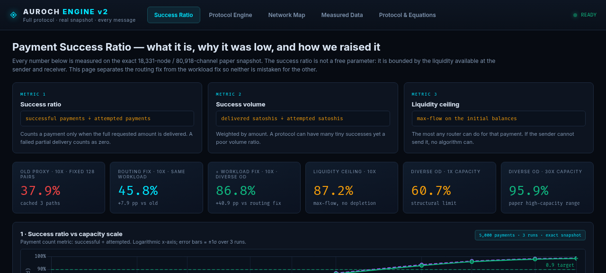

# Auroch — Full Story V2 (all questions answered in one brief file)

Live: https://auroch.dhruvmulani.com/ · GitHub: https://github.com/DHRUV-MULANI/auroch-engine-v2

Purana `FULL_STORY.md` bhi wahi hai; ye V2 usme **7 naye clarified points** jodta hai. Sab full forms pehli baar par likhe hain.

---

## 0. Full forms (chhoti list)

| Short | Full form / matlab |
|---|---|
| Auroch | "**A**uroch: **A**uction-Based **M**ultipath **R**outing for **P**ayment **C**hannel **N**etworks" — paper ka naam |
| PCN | **Payment Channel Network** — off-chain payment network |
| OD | **Origin–Destination** = sender aur receiver |
| RREQ / RREP | **Route Request** / **Route Reply** |
| AUC | **Auction** |
| LP | **Linear Programming** (Eq6 = auctioneer LP, Eq7 = sender LP) |
| HTLC | **Hashed Timelock Contract** |
| τ / α | **liquidity fee** / us fee ka exponent |
| sat | **Satoshi** (1 BTC = 10 crore satoshi) |
| proxy | **stand-in model** — paper ka code na hone se banaya simplified program. VPN proxy **nahi** |
| old proxy | pehla stand-in = `cached3` + `fixed128` |
| cached 3 | 3 shortest paths ek dafa save, baar baar reuse (live balance nahi dekhte) |
| fixed 128 | 128 OD pairs, 5,000 payments par baar baar reuse |
| flow | har payment par fresh **maximum flow** on live residual balances |
| diverse | har payment ka naya independent OD pair |
| ceiling | upper bound: flow solver untouched balances par (no depletion) |
| σ | **standard deviation** (3 runs ka spread) |
| pp | **percentage point** |

---

## 1. Auroch kya hai (ek line)

PCN mein payment ko **auction** se paths chun ke **multiple paths** par baanta hai, aur jis node ki liquidity kam ho uski fee τ badha deta hai — taaki traffic doosri taraf jaaye. Paper ke 3 **stages**: setup/RREQ-RREP → route auctioning → route selection. Eq1 reservation price, Eq2–3 Rule 1, Eq4–5 Rule 2, Eq6 auctioneer LP, Eq7 sender LP — sab engine mein chalte hain.

---

## 2. Cached 3 / Fixed 128 kisne choose kiya? (paper ne NAHI)

Paper ka "3" = **3 stages** aur toy example mein 3 auctioneer — kahin bhi "3 paths" ya "128 pairs" nahi likha.

Asli source purana code `old_project/scripts/full_experiment.py`:
- line 118: `"auroch": paths[:3]` → 3 paths khud choose kiye
- line 359: *"greedy capacity split across up to 3 cached low-weight simple paths; **no auction/bidding/Eq.6 LP**"* → ek engineering shortcut
- line 258: `--od-pairs default=128, help="...to keep full grid tractable"` → sirf runtime compromise

Kyun 3? 1 path = multipath nahi; 100 paths = 18k-node graph par mehenga; 3 = baselines jaisa (Spider 4, SpeedyMurmurs 3 landmarks) aur compare karne ke liye kaafi.
Kyun 128? Sirf experiment chalane ke liye; naya pair har payment par hota to cache ka fayda khatam.

**Matlab 37.9% "old proxy" Auroch ka asli score nahi tha** — ek simplified stand-in ka score tha (3 stale paths + no auction + 128 drained endpoints). Isliye do fixes alag report kiye: routing `flow` → 45.8% (+7.9 pp), workload `diverse` → 86.8% (+40.9 pp). 128 wali choice limitation thi, algorithm ki kamzori nahi.

---

## 3. 3 paths kyun aur water-filling kyun

- **3** purane proxy ki fixed setting hai (upar wala point). Paper se nahi.
- **Water-filling** = payment ko paths par capacity ke hisaab se baantna (jaise bartanon mein pani — chhota pehle bharo, phir level barabar). Isse koi path overload nahi hota.
- Purana proxy ye stale 3 paths par karta tha → end tak paths dry, phir bhi wahi par pani → failure.

---

## 4. Flow method — "paths as many as needed" kaise

Naya method path count **decide nahi karta**, wo nikal aata hai:

1. `capped = min(available_balance, payment_amount)` — 50,000 sat wale channel ki capacity 1,000 sat ke payment ke liye 1,000 hi (zyada bhejna hai hi nahi; 70× par int32 overflow se bachat bhi).
2. Virtual **super source** → sender aur receiver → **super sink**, dono `amount` capacity ke. Max-flow value `amount` se upar nahi ja sakti.
3. `scipy.maximum_flow`: value < amount → payment **fail**; value ≥ amount → deliverable.
4. Flow ko paths mein todna:
   ```
   left = amount
   jab tak left > 0:
       positive flow wala koi path dhundo (DFS)
       bottleneck = min(left, path par sabse chota flow)
       usse ghata do, record karo, left -= bottleneck
   ```
   Loop tab rukta hai jab `left = 0`. Ginti predefined nahi.

Agar ek path ki bottleneck ≥ amount → pehla DFS poora amount dal deta hai → **1 path**.
Kab 2? Path A 400 + Path B 600 = payment 1,000 → **2 paths**.

| Method | mean paths @10× | Kyun |
|---|---|---|
| `cached3` | **3.89** | forced 3+ paths, chahe zarurat ho ya na |
| `flow + fixed128` | **1.06** | ~94% ko 1 path, ~6% ko 2 |
| `flow + diverse` | **1.14** | ~86% ko 1 path, ~14% ko 2 |

`mean_paths = paths / successful` — sirf safal payments par average.

---

## 5. Step 4 experiment — exact kya kiya

`scripts/success_experiment.py`; input exact snapshot **18,331 nodes / 80,918 channels**.

| Cheez | Exact |
|---|---|
| Series (method + workload) | 5: `cached3+fixed128`, `flow+fixed128`, `flow+diverse`, `ceiling+fixed128`, `ceiling+diverse` |
| Capacity scales | 10: 1, 2, 3, 5, 7, 10, 20, 30, 50, 70 |
| Summary rows | 5 × 10 = **50** |
| Runs | 3 tareeqe × 10 × 3 = 90, + 2 ceiling × 10 × 1 = 20 → **110** |
| Payments | 110 × 5,000 = **5,50,000 attempts** |
| Compute | **1,375.6 s** (~23 min) |
| Seed | **20261116** → dobara chalane par wahi payments (repeatable) |
| Amounts | log-uniform **1,000–1,000,000 sat** (chhote zyada, bade kam) |
| Liquidity | **50:50** dono directions (10,000 capacity → 5,000 + 5,000) |
| Policies | ignore |
| Parallel channels | aggregate (3 channels = 1 channel, capacity jog) |
| 3 runs | mean + **±1σ** ke liye; ceiling 1 run (deterministic) |

**Exam analogy:** 5 tareeqe × 10 levels = 50 results; har tareeqa 3 baar exam deta hai (har baar 5,000 sawal); ceiling 1 baar (usme luck nahi).

**"Full run" kyun nahi:** paper ka code nahi (isliye proxy), real Bitcoin/Ripple trace nahi (isliye synthetic amounts), 1,542 snapshots se naya info nahi (topology ~0.4% badalti hai), 18k nodes par sab OD pairs tractable nahi, 20+ runs se fayda nahi (σ≈0.002). 5,000 × 3 = practical + repeatable + statistically kaafi.

---

## 6. 10× kya hai

Har channel ki capacity ×10. Nodes, pairs, amounts wahi.

| Channel | Original | 10× | 50:50 split |
|---|---|---|---|
| Alice→Bob | 1,000 sat | 10,000 sat | 5,000 dono taraf |

Poochein: *"Agar network mein 10 guna paisa hota to kitne payments safal hote?"* — isse **algorithm ki ability** aur **liquidity limit** alag ho jate hain.

| Capacity | Diverse success | Matlab |
|---|---|---|
| 1× (asli) | **60.7%** | ~39% local liquidity se block |
| 10× | **86.8%** | 0.8–0.9 yahan se |
| 30× | **95.9%** | target cross |
| 70× | **98.5%** | near-perfect |

1× = asli network; 10× = **what-if stress test**. 0.8–0.9+ jawab conditional hai: 10×+ aur diverse par haan, 1× par nahi.

---

## 7. Fraction aur "downword"

```
success_ratio  =  successful_payments  /  attempted_payments
                  ↑ numerator             ↓ denominator

success_volume =  delivered_sats       /  attempted_sats
```

`attempted` **neeche (denominator)** isliye kyunki sawal hai *"kitne percent attempts safal hue?"* — base = total attempts. 4,342 / 5,000 = **86.8%**. Ulay karne (5,000 / 4,342) ka matlab "ek safal payment ke liye kitne attempts" — bekaar number.

Agar "downward" se matlab **position chart ki giravi** thi: `cached3` **78.3% → 12.7%** isliye girti hai kyunki same 128 endpoints ka paisa khatam hota hai (drain); `diverse` **87.9% → 87.5%** flat kyunki har payment naya pair.

---

## 8. Dijkstra / SpeedyMurmurs / Spider — code hai ya nahi?

**Inka asli code nahi** — sirf papers. Purane repo `scripts/full_experiment.py` mein humne **apne stand-in** banaye:

| Naam | Humara proxy |
|---|---|
| `dijkstra_proxy` | ek cached shortest path; bottleneck kam → fail |
| `speedymurmurs_proxy` | 3 high-degree landmarks mein se ek ke tree par single route |
| `spider_proxy` | 4 edge-disjoint cached paths par capacity split |
| `auroch_proxy` | 3 cached paths par greedy split (no auction/Eq6 LP) |

Purana experiment (20 runs × 3 counts × 3 scales) chal ke output `averaged.csv` / `measured_results.json` mein gaya. **Engine v2 ka naya experiment sirf `cached3`, `flow`, `ceiling` chalata hai** — Dijkstra/Speedy/Spider ko dobara nahi chalaya; unke **measured numbers** copy kiye aur Measured Data tab mein **live Chart.js** plot banaye.

- purana code → numbers banata hai
- naya engine → numbers se graph draw karta hai
- dono jagah `paper_faithful_reproduction: false`

Isliye ye "Dijkstra ka asli score" **nahi**, "Dijkstra-inspired proxy ka proxy score" hai.

---

## 9. Final output (exact numbers)

| What | Capacity | Success | Count |
|---|---|---|---|
| Old proxy `cached3+fixed128` | 10× | **37.9%** | 1,890/5,000 |
| Routing fix `flow+fixed128` | 10× | **45.8%** | 2,251/5,000 |
| Workload fix `flow+diverse` | 10× | **86.8%** | 4,342/5,000 |
| Ceiling `diverse` | 10× | **87.2%** | 4,361/5,000 |
| Diverse | 1× | **60.7%** | 3,043/5,000 |
| Diverse | 30× | **95.9%** | 4,813/5,000 |
| Diverse | 70× | **98.5%** | 4,933/5,000 |

Volume @10×: old 15.3%, routing 25.4%, diverse 55.4%, ceiling 56.5% (volume < count kyunki bade payments fit nahi hote).



Services: `auroch-app` + `auroch-tunnel` enabled/active, local aur public dono HTTP 200. Token repo mein nahi.

**Caveat (har number ke saath):** synthetic amounts, 50:50 liquidity, policies ignored, parallel aggregate, flow solver = Eq7-style feasibility (poora auction/HTLC stack nahi), `paper_faithful: false`. Koi fudging nahi.

## 10. Reproduce

```bash
cd /home/boss/Documents/Collage/BTP/auroch-engine-v2
python3 scripts/success_experiment.py && npm run build
systemctl --user restart auroch-app.service auroch-tunnel.service
curl -sS -o /dev/null -w '%{http_code}\n' https://auroch.dhruvmulani.com/
git add FULL_STORY_V2.md && git commit -m "Add FULL_STORY_V2" && git push origin main
```
